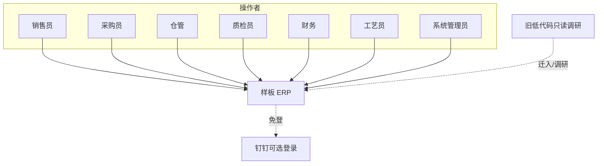
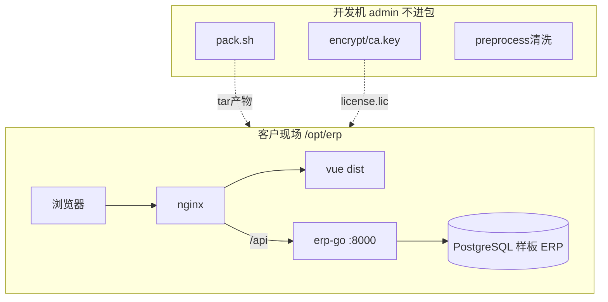
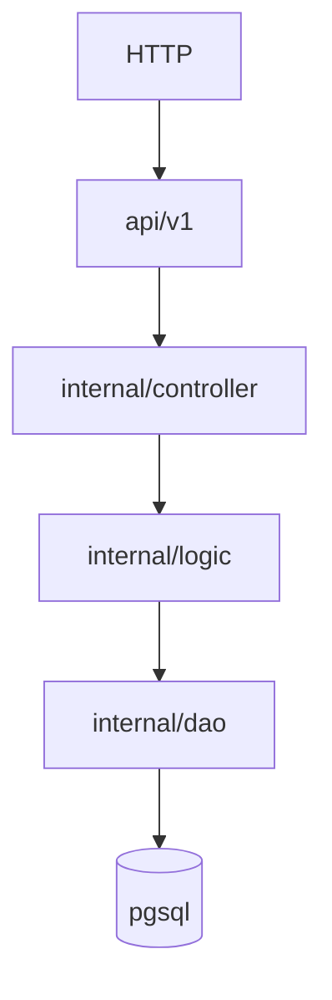
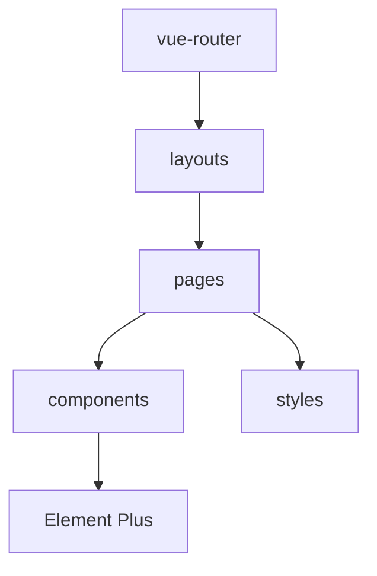
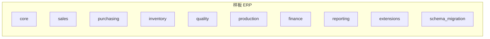
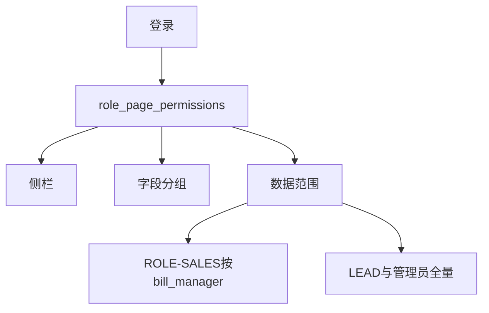
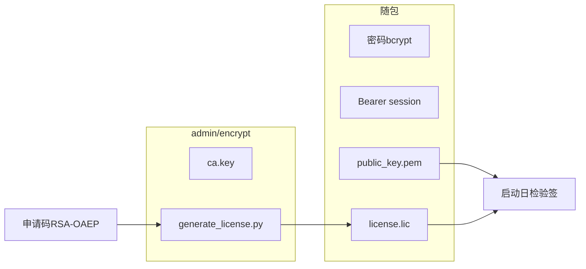
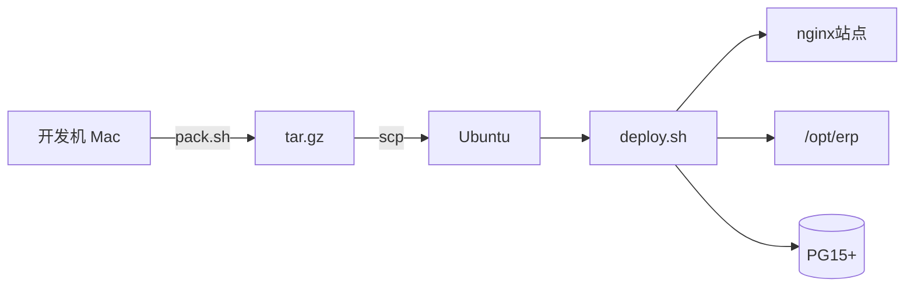
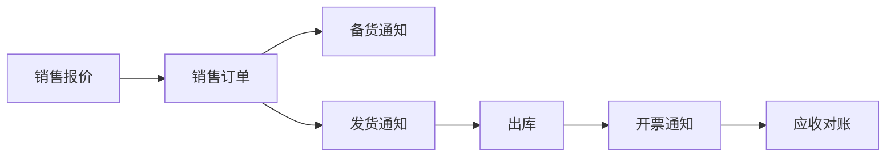

# 金样：样板 ERP → erp-go-vue-pg

本文件是 **arch-jiagou** 对样板 ERP 的映射索引与填好的标准图。  
**不替代**仓库内 `AGENTS.md` / PRD / 说明书；逆向生成 harness 时以仓库现行文件为准，diff 后勿静默覆盖。

## 选型表（摘要）

| 轴 | 选定 |
|---|---|
| 1 技术栈 | Vue3+TS+Element Plus+Vite；Go+GoFrame；PostgreSQL 多 schema；nginx+本机 API |
| 2 业务流程 | 跨模块下推通知/草稿；自动/手动按下推方主观决策；进度现算；权限不越界 |
| 3 样式 | `vue/src/styles/`；弹窗 dialog.css + doc-form.css |
| 4 调研 | `docs/旧低代码系统调研记录/`；生产零写入 |
| 5 对象 | 制造业 ERP；读者=业务操作者；岗位含销售/采购/仓/质检/财务/工艺/管理员 |
| 6 权限 | 页面 can_view/can_edit + 字段分组；员按 bill_manager/inspector 等收窄，主管全量 |
| 7 部署 | `admin/release` 打包；目标机 deploy；config 深合并；PG15+ |
| 8 手术刀 | agent 分层 AGENT；复用优先；禁止平行造轮子 |
| 9 数据 | 单据落表、nanoid24、删除作废、源头同步、公式说明书 |
| 10 文档入口 | AGENTS 按需加载表 + docs 唯一入口 |
| 11 授权 | 申请码 RSA-OAEP；license 验签；私钥 admin/encrypt |
| 12 验收 | Chrome+Playwright；多帐核对；测完即清 |
| 13 能力装配 | 开闭已登记能力，非 BPM |

## 仓库入口映射

| Skill 产物 | 样板 ERP 现行 |
|---|---|
| 根 AGENTS | `/AGENTS.md` |
| 前端 | `agent/AGENTS-前端.md` |
| 后端 | `agent/AGENTS-后端.md` |
| 数据 | `agent/AGENTS-数据.md` |
| 测试 | `agent/AGENTS-测试.md` |
| 流程 | `agent/AGENTS-研发流程.md` |
| admin | `admin/AGENTS.md` |
| 架构图 | **现行缺失独立 `docs/架构图/`**（见下方已填图；回写须鲁大师确认） |
| 公式 | `docs/计算公式说明书.md` |
| 库结构 | `docs/数据库说明书.md` |
| 权限 PRD | `docs/PRD及测试用例/系统设置-用户角色权限PRD.md` |
| 部署 SOP | `docs/打包部署/打包部署SOP.md` |

## 已填标准图（金样正文）

### 01 系统上下文

### 02 容器

### 03 后端分层

### 04 前端壳

### 05 数据域

`public` 保持空。

### 06 权限

### 07 授权

### 08 部署

config.yaml 保留且按 example 深合并补缺键。

### 09 业务主链（销售履约例）

备货/发货通知：手动下推（有分批时机决策）。进度现算自真实单据。

## 与 skill 的匹配缺口

以 skill 内 [COMPARISON.md](../COMPARISON.md) 双列表为准。
摘要：样板 ERP 缺架构图套装（列表 B）；skill 缺词表/公式正文/stockpost/search_path 等项目特化（列表 A）。
流程族/金样框架/双说明书规则已进 skill 详文。
